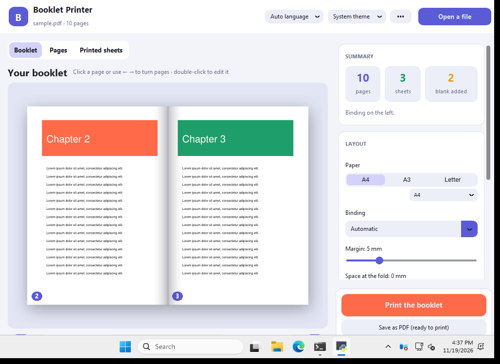

# Booklet Printer

[Français](README.fr.md) · English

Desktop app that turns a **PDF** or a **PowerPoint (PPTX)** presentation into a
**saddle-stitched booklet**: you leaf through the booklet exactly as it will look,
fix any page that is wrong, and print it double-sided. Then fold the stack in half
and staple on the fold.

[](https://github.com/ElMastho/booklet-printer/actions/workflows/ci.yml)



## Download (Windows)

Download `BookletPrinter.exe` from the
[latest release](https://github.com/ElMastho/booklet-printer/releases/latest) and run it.
Nothing to install.

* The executable is not code-signed, so Windows SmartScreen may say “Windows protected your PC”.
  Click **More info → Run anyway**.
* Keep the exe in a folder you can write to (Desktop, Documents…), not in `Program Files`,
  so that automatic updates can replace it.

## Using it

1. **Open a file** (PDF, PPTX, PPT, ODP, DOCX…).
2. **Booklet** view: the folded booklet, page after page. Click a page or use ← → to turn
   pages. Every page shows its booklet page number at the bottom left, and the bar below
   tells you on which sheet, front or back, it will be printed.
3. **Pages** view: fix anything that is wrong.
   * drag and drop pages to reorder them (Ctrl/Shift-click to select several);
   * move earlier/later, move to a given position, duplicate, delete;
   * insert blank pages, rotate by 90°;
   * crop a page by drawing a rectangle on it (or type the margins in mm);
   * shrink a page and shift it inside its half-sheet;
   * apply the same adjustment to every page, reset a page, undo/redo everything.
   Double-click a page in the booklet or in the printed sheets to jump to it.
4. **Printed sheets** view: each physical sheet, front and back, with the page numbers it carries.
5. **Print the booklet**, or save the print-ready PDF to print it from another program.
6. Nest the sheets (sheet 1 outside), fold in half and staple on the fold.

The interface is available in **English and French**. It follows the language of the computer
by default and can be switched from the header. Light and dark themes are available too.

### How the imposition works

* The page count is padded with blank pages up to the next multiple of 4 (at the end, or just
  before the last page when “Last page on the back cover” is on).
* Two pages per side, four per sheet, in saddle-stitch order. With 8 pages:
  sheet 1 = front 8 | 1, back 2 | 7; sheet 2 = front 6 | 3, back 4 | 5.
* Pages are scaled to fit their half-sheet, keeping their proportions, and centred.
* **Binding**:
  * *Left*: classic booklet, A4 landscape sheet → A5 portrait booklet;
  * *Right*: right-to-left reading (manga, Arabic, Hebrew);
  * *Top* (calendar): A4 portrait sheet, two landscape pages one above the other → great for
    16:9 slides, which stay large;
  * *Automatic*: “top” when most pages are landscape (slides), otherwise “left”.

### Print settings

Booklets are always printed **double-sided, flipped on the short edge, at 100 % scale**.

* **Windows**: the app drives the printer directly (GDI) and forces these settings
  (orientation, paper size, short-edge duplex, number of copies).
* **macOS / Linux**: printed through CUPS (`lp -o sides=two-sided-short-edge`).
* **Printer without duplex**: turn off “My printer prints double-sided”. The fronts are printed,
  the app asks you to turn the stack over (on the short edge) and then prints the backs.
  If your printer outputs the backs in the wrong order, turn on “Reverse the order of the backs”.
* When printing the saved PDF from another program, choose *Two-sided → Flip on short edge*
  and *Actual size / 100 %* (not “Fit”).

## PowerPoint files

`.pptx`, `.ppt`, `.odp` (and `.docx`, `.odt`) files are converted to PDF first:

1. with **LibreOffice** when it is installed (recommended, free: <https://www.libreoffice.org>);
2. otherwise, on Windows, with **Microsoft PowerPoint** when it is installed.

LibreOffice is found automatically; its path can also be forced with the `BOOKLET_SOFFICE`
environment variable. For a result identical to PowerPoint, exporting the presentation to PDF
from PowerPoint is still the most faithful option.

## Automatic updates

On start-up the Windows executable checks the latest
[GitHub release](https://github.com/ElMastho/booklet-printer/releases). When a newer version
exists it offers to install it: it downloads the new exe, closes, replaces itself and restarts.
Use **⋯ → Check for updates** to check on demand.

## Command line

```bash
BookletPrinter.exe                         # graphical interface
BookletPrinter.exe document.pptx           # graphical interface with the file open
python -m booklet_printer doc.pdf -o booklet.pdf [--paper A4] [--binding auto|left|right|top]
        [--margin 5] [--gutter 0] [--pages "1-4,blank,6,5,8-,7:r90"]
        [--keep-back-cover] [--fold-marks] [--split] [--export-pages edited.pdf] [--lang en|fr]
python -m booklet_printer doc.pdf --print [--printer "Name"] [--copies 2]
```

* `--pages` sets the page order: page numbers, ranges (`8-5` goes backwards), `blank`, and
  `:r90` / `:r180` / `:r270` to rotate a page.
* `--split` also writes `booklet-fronts.pdf` and `booklet-backs.pdf` for manual duplex.

## Development

```bash
python -m venv .venv && . .venv/bin/activate      # Windows: .venv\Scripts\activate
pip install -r requirements-dev.txt
python -m pytest
python -m booklet_printer                          # start the interface
pyinstaller --onefile --windowed --name BookletPrinter --collect-data customtkinter run_app.py
python scripts/ui_screenshots.py screenshots en light   # screenshots of every view
```

| Module | Role |
| --- | --- |
| `booklet_printer/imposition.py` | Page order, geometry, imposed PDF generation (PyMuPDF) |
| `booklet_printer/pages.py` | Editable page plan: order, blanks, rotation, crop, scale, offset, undo |
| `booklet_printer/convert.py` | PPTX → PDF conversion (LibreOffice, or PowerPoint on Windows) |
| `booklet_printer/printing.py` | Printing (GDI on Windows, CUPS elsewhere) |
| `booklet_printer/updater.py` | Automatic updates from GitHub Releases |
| `booklet_printer/i18n.py` | English and French strings, system language detection |
| `booklet_printer/ui/` | CustomTkinter interface: booklet view, page organizer, printed sheets |
| `booklet_printer/cli.py` | Entry point (interface or command line) |

### Releasing

1. Bump `__version__` in `booklet_printer/__init__.py`.
2. Commit and push to `main`.
3. In [Actions → CI → Run workflow](https://github.com/ElMastho/booklet-printer/actions/workflows/ci.yml),
   tick “Publish release” (or push a `vX.Y.Z` tag matching the version).
4. CI runs the tests (Linux and Windows), builds `BookletPrinter.exe`, smoke-tests it and creates
   the GitHub release with the exe: existing installations update themselves.

## License

MIT
